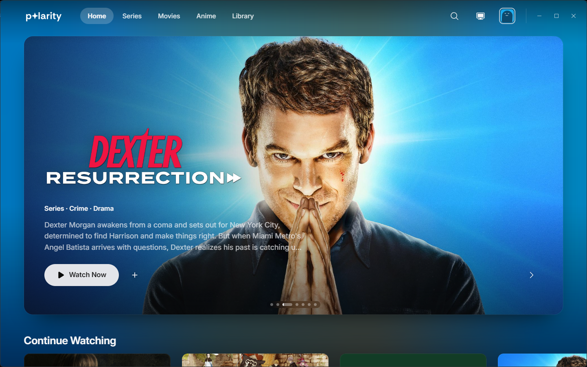
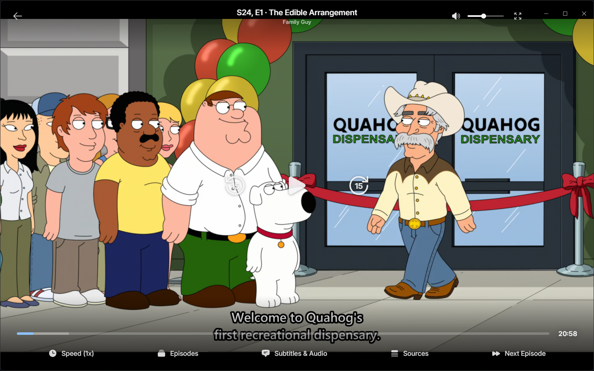

<p align="center">
  
</p>

<p align="center">
  A desktop app for browsing shows, movies and anime, and playing streams from Stremio-supported addons.
</p>

<p align="center">
  
</p>

## What's in it

**Browse**
- Home with a featured hero, Continue Watching and trending rows
- Separate Series and Movies pages, plus browsing by genre
- A dedicated Anime section with its own search, details and episode lists
- Search with recent searches
- IMDb ratings on cards and title pages, and trailers on the title backdrop
- A calendar built from the shows in your library and the ones you're watching

**Watch**
- Plays most files through a bundled mpv player, inside the app window
- Pick the source, subtitles, audio track and speed from the player bar
- Episode shelf and a Next Episode button
- Skip intros and recaps, and skip filler episodes in anime
- Subtitle, sound and picture settings that apply straight away, even mid-video
- Source filters, and a check of a stream before it plays
- Resume where you left off

**Library**
- Watchlist, history and your own playlists
- Download titles to watch later
- Right-click menu on any card for quick actions

**Together**
- Accounts and profiles with their own avatars, synced between your devices
- Watch parties, so everyone's player stays in step
- TV mode for the couch, with a controller and remote-style navigation


## Screenshots

### TV mode

Big cards, a clock, and everything reachable with a controller or the arrow keys.


### Player

Subtitles, audio, sources and episodes sit in the bottom bar.



## Getting started

You'll need [Rust](https://rustup.rs), [Bun](https://bun.sh), and on Windows the MSVC C++ Build Tools.

```sh
bun install
bun run app
```

To run the optional catalog addon:

```sh
bun run index
```

## Setup

1. Open Settings and add a Stremio addon URL.
2. Optionally add a TMDB API key. Without one, the catalog uses Cinemeta.

## Built with

[Tauri](https://tauri.app) and Rust for the app shell, React and TypeScript for the interface, and [mpv](https://mpv.io) for playback.
