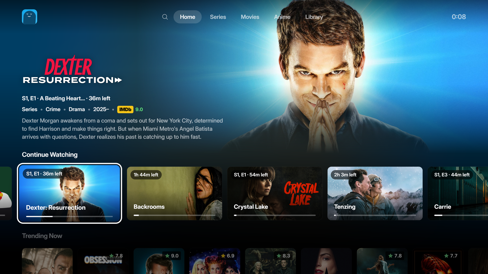

<p align="center">
  
</p>

<p align="center">
  A desktop app for browsing shows, movies and anime, and playing streams from Stremio-supported addons.
</p>

<p align="center">
  
</p>

## What's in it

**Browse**
- Home with a featured hero, Continue Watching and trending rows
- Separate Series and Movies pages, plus browsing by genre
- A dedicated Anime section with its own search, details and episode lists
- Search with recent searches
- IMDb ratings on cards and title pages, and trailers on the title backdrop
- A calendar built from the shows in your library and the ones you're watching

**Watch**
- Plays most files through a bundled mpv player, inside the app window
- Pick the source, subtitles, audio track and speed from the player bar
- Episode shelf and a Next Episode button
- Skip intros and recaps, and skip filler episodes in anime
- Subtitle, sound and picture settings that apply straight away, even mid-video
- Source filters, and a check of a stream before it plays
- Torrent streams that your own add-ons return play with a built-in engine on desktop, with a cache limit, an optional speed limit and nothing shared after playback unless you turn it on
- Resume where you left off

**Library**
- Watchlist, history and your own playlists
- Download titles to watch later
- Right-click menu on any card for quick actions

**Together**
- Accounts and profiles with their own avatars, synced between your devices
- Watch parties, so everyone's player stays in step
- TV mode for the couch, with a controller and remote-style navigation


## Screenshots

### TV mode

Big cards, a clock, and everything reachable with a controller or the arrow keys.



### Player

Subtitles, audio, sources and episodes sit in the bottom bar.


## Getting started

You'll need [Rust](https://rustup.rs), [Bun](https://bun.sh), and on Windows the MSVC C++ Build Tools.

```sh
bun install
bun run app
```

To run the optional catalog addon:

```sh
bun run index
```

## Setup

1. Open Settings and add a Stremio addon URL.
2. Optionally add a TMDB API key. 

Settings, keys and add-on URLs are kept in `polarity.json` in the app's data folder (called `polar.json` in
earlier versions; the first start renames it and keeps the old one as `polar.json.moved`). On Linux and macOS
only your user account can read it, and Windows keeps app data per user, but it isn't encrypted:
other programs running as you can read your keys. Your sign-in session is kept in the system's
keychain (Keychain on macOS, Credential Manager on Windows, the Secret Service such as GNOME Keyring
or KWallet on Linux), under `app.getpolar.desktop`; where there is none, the app keeps it itself, as
before. Signed in to an account, your settings, keys and add-on URLs sync between your devices.
Keys and add-on URLs are protected by your sign-in but stored readable on the server, unless you set
a passphrase in Settings → Account → API keys and addons: then they travel encrypted, and each
device asks for the passphrase once.

When something goes wrong, `polar.log` says what: `%LOCALAPPDATA%\app.getpolar.desktop\logs` on Windows,
`~/Library/Logs/app.getpolar.desktop` on macOS, `~/.local/share/app.getpolar.desktop/logs` on Linux. It
names hosts and reasons, never keys, links or what you watch, and stays under about 2 MB.

## Contributing

How the code is put together, and where each feature above lives: [docs/ARCHITECTURE.md](docs/ARCHITECTURE.md).
The interface's components and conventions: [docs/ui-components.md](docs/ui-components.md). What could only be
read, not run, before release, and how to check it: [docs/unverified.md](docs/unverified.md). Checks to run before
a pull request: `bun run typecheck`, `bun run test`, and `cargo test --workspace`; CI runs these and the Playwright
tests (`bun run e2e`) on every push, and a smoke test of the built app nightly. How to run and add each kind of test:
[docs/testing.md](docs/testing.md).

What the project won't accept, and the rules coding agents follow: [CONTRIBUTING.md](CONTRIBUTING.md),
[AGENTS.md](AGENTS.md).

Screenshots and recordings for the README use openly licensed films only: [docs/screenshots.md](docs/screenshots.md)
explains how to play one in Polarity and how to credit it.

## Licence

MIT, see [LICENSE](LICENSE). Bundled fonts, avatars and mpv keep their own licences: [docs/licensing.md](docs/licensing.md).

## Built with

[Tauri](https://tauri.app) and Rust for the app shell, React and TypeScript for the interface, and [mpv](https://mpv.io) for playback.
