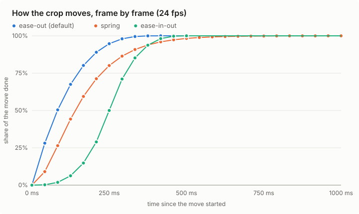

# Autocrop: removing black bars without the viewer noticing

Status, 2026-11-06: built and tested in `crates/player`: the detector and the crisp-edge lock
(§2), the pre-roll's choice of opening bars (§3, `crop::opening_bars`, `CropTracker::open`),
animated bars (§5, `CropTracker::following`), eased moves (§6, `motion::Glide`,
`crop::CropZoom`). The desktop engine (`src-tauri/src/player/autocrop.rs`) jumps on the cut
and eases late changes, and reads frames with our detector (§2, "Our detector on the desktop"):
every frame on macOS, around cropdetect's changes on Windows and Linux, every frame there with a
setting; built and type-checked, untested with a real mpv (docs/unverified.md). The
pre-roll probe (§3) is wired in the desktop engine (`src-tauri/src/player/preroll.rs`) for
mpv as its own process (Windows), not yet for libmpv in the app (macOS); it type-checks here and is untested with a real mpv
(docs/unverified.md). The lookahead (§4) is wired there too, by range requests from a second
probe (way 2), untested with a real mpv and not yet measured.
The aim is crop changes the viewer doesn't notice: a change on a cut jumps on the cut frame,
and ease-out is the default for the rest.

## 1. Before our detector (desktop)

mpv ran FFmpeg's `cropdetect` on every frame (`crop::CROPDETECT`, `reset=1`), and
`CropTracker` (`crates/player/src/crop.rs`) decided from those readings which bars to remove;
`src-tauri/src/player/autocrop.rs` turns that into `video-zoom`. What the viewer saw: the first
crop came a few frames into the film, and on a change of bars the crop followed a few frames
late (4 frames for a common shape, 12 for an odd one). Such a late change is eased
(§6) and one seen on the frame it happens (back to full frame, picture in a cropped bar) jumps.
cropdetect still reads each frame on Windows and Linux; §2 says where our detector takes over.

## 2. Our own detector (`crates/player/src/bars.rs`)

FFmpeg's `cropdetect` is a GPL-only part, so the LGPL build (iOS, `plan-mobile.md` §7) has
none. `bars::detect` is an **independent implementation**, written from the idea and not from
`vf_cropdetect.c` (which a port would make GPL). Per frame:

- A line (row or column) is **bar** when at most 1% of 512 samples along it are lit (more than
  `limit` above `black`: 12 steps for SDR, 9 for HDR). Counting lit samples, not averaging,
  keeps a dark line with a few highlights (stars, a lamp) as picture.
- Bars run in from each edge; columns are judged over the picture's rows only, so a letterbox
  doesn't dilute them. A frame with no lit line (a fade) gives no reading.
- An edge is **crisp** when a line within 3 of the bar has at least 25% lit samples: the picture
  starts at once. Dark picture next to a bar comes up over many lines and isn't crisp.

`CropTracker::update_measured` takes crisp edges as leave to crop sooner: bars crisp on both
sides of an axis are cropped on their first frame when they leave a common shape (2.39:1,
1.85:1, 4:3, ...), after 2 frames otherwise. A wrong crop shows for one frame, since picture in
a cropped bar un-crops at once. Readings: luma (`Luma8`) or mpv's `screenshot-raw` (`Bgr0`).

**Measuring it against cropdetect.** `bun scripts/autocrop-compare.ts <film>` cuts shots from a
film without bars of its own (Sintel, Tears of Steel), frames each as full frame, 2.39:1, 1.85:1
or 4:3 at 1920x1080, so the truth is known, and runs both detectors through the same tracker
(`cargo run --release -p polar-player --example autocrop_compare`). Columns: time to first crop
per change of bars, bars never cropped, crop changes per minute, frames that cut picture off,
frames that leave bars on screen. A second table counts how each crop change would be shown (§6):
on the cut, following animated bars, eased because caught late, correcting a misread (at once
or eased), and changes into a misread. A third table gives, per shot, the frames that cut picture
off, and our detector also runs at its earlier limit (24) and at cropdetect's level (8) for comparison. Needs an ffmpeg built
with `cropdetect` (a GPL build) and a test film (Sintel from download.blender.org).

**First results** (16 shots of 8 s each, 2026-11-05). On Tears of Steel our detector does
better on every column: first crop 0 ms on average against 42, no frame cutting picture against
2, and 13 of 15 crop changes on the cut. On Sintel it crops sooner (500 ms against 792) and leaves
bars on fewer frames (40 against 115), but cuts picture on more (114 against 78), and as many
with crisp edges ignored, so the extra cut comes from the readings, not the crisp lock. Likely
cause, to be confirmed by the limit rows: cropdetect's `limit=0.09` is compared with
limited-range luma as decoded, so a line is picture from about 7 steps above black (16), while
our 24 steps over full-range luma is about 21 limited steps, so dim picture at the edge of
Sintel's dark shots reads as bar.

**Limit rows** (same clips, our detector at 16, 12 and 8). Lower is better on every column
of both films. On Sintel, picture is cut on 92, 89 and 86 frames, against 114 at 24 and 78 for
cropdetect; bars are left on 28, 16 and 12 frames (115 for cropdetect); the first crop comes
at 417, 375 and 333 ms on average (792); and 10 to 12 of 15 changes land on the cut (4).
On Tears of Steel, 12 and 8 are right on every frame. The limit is now **12** (HDR 9, in
cropdetect's ratio): nearly all the gain of 8, with some room for grain in the bars of real
releases, which the clean padding of these clips doesn't test.

The per-shot table also showed a fault in the measuring itself: on Sintel, shots without bars
of their own cut picture on 1, 2, 3, 4, 5, then 6 frames, one more with each shot, while cropdetect
cut none. The clip decoded to 3078 frames, not 16 × 192: written as rawvideo, ffmpeg keeps a
constant frame rate and repeated a frame at six joins, so our detector's frames fell behind the
truth and cropdetect's readings. The script now decodes every frame once (`-fps_mode
passthrough`), and `autocrop_compare` stops when the frame count or cropdetect's readings don't
match the clip. Our rows on Sintel above therefore counted too many frames cutting picture (at least those 21).

**Run again with every frame decoded once** (85017d7, 3072 frames per film, limit 12). Our
detector is ahead of cropdetect on every column of both films. Sintel: first crop 208 ms on
average against 792, picture cut on 52 frames against 78, bars left on 6 against 115, and 10 of
the changes on the cut against 4. Tears of Steel: right on every frame (first crop 0 ms, nothing
cut, no bars left) against 42 ms, 2 and 12 for cropdetect. What cuts picture on Sintel is two
shots (22 and 30 frames, cropdetect 42 and 35), dark scenes whose dim edges both detectors read
as bar. The limit 8 row is slightly better on Sintel (49 and 2); 12 stays, for the grain these
clips don't have.

### Our detector on the desktop

cropdetect runs inside mpv; our detector needs the frame's pixels, and gets them as a screenshot
of the frame on screen in mpv's own copy (`video`: the decoded frame at its size, unzoomed, without
subtitles). `polar_player::sampler` decides, frame by frame, which reading goes to the tracker:

- **macOS: every frame, in memory.** libmpv runs in the app, so `screenshot-raw video` hands
  the frame over as `bgr0` through a weak client of the player (`mac::Frames`,
  `polar_mpv_frame` in `src-tauri/src/macos/mpv_view.m`). cropdetect isn't run, so hardware
  decoding stays zero-copy (no copy-back, `Tune::hwdec_mode`).
- **Windows and Linux, by default: around changes.** cropdetect reads each frame. When its
  reading changes, a screenshot is taken (an uncompressed PNG, `--screenshot-png-compression=0`,
  read by `polar_player::png` and deleted), then more, one at a time, while our readings keep
  moving or the tracker follows animated bars (§5), until 3 in a row agree. Meanwhile only our
  readings feed the tracker, so crisp edges and follow mode work as on every frame. A screenshot
  that hasn't come within 12 frames gives way to cropdetect again.
- **Windows and Linux, opt-in: every frame.** Settings → Advanced, "Check every frame for black
  bars" (off by default, for powerful computers): a screenshot of every frame, one at a time,
  and no cropdetect, so no copy-back either.

A screenshot is of the frame on screen and arrives a frame or two after it was asked for, so a
change it finds lands that much after its cut (cropdetect's readings run a frame ahead). The
lookahead (§4) still puts known changes on the cut itself.

**What it costs.** Per frame, measured here (`cargo run --release -p polar-player --example
autocrop_cost`, one core of an i7-10710U), with a letterboxed picture:

| frame | PNG per frame | written per second at 24 fps | read PNG + detect | detect on `bgr0` (macOS) |
|---|---|---|---|---|
| 1920x1080 | 6.22 MB | 149 MB | 5.6 ms | 0.64 ms |
| 3840x2160 | 24.89 MB | 597 MB | 19.3 ms | 1.43 ms |

So every frame on Windows writes about 150 MB a second for 1080p and 600 MB for 4K (each file is
deleted at once, but the writes happen), and Polarity spends about an eighth of a core reading
1080p (half a core for 4K). Around changes, the default, writes only for the second or so after a
change. On macOS nothing is written and our side costs under 1.5 ms a frame. mpv's own share
(reading the frame back from the GPU, writing the PNG) and the screenshots per second it keeps
up with need the desktop build: the engine logs both every 10 s while screenshots are taken
(`autocrop: N screenshots/s, N MB/s written, N ms each reading them here`), to be filled in here
and in the setting's caption (docs/unverified.md).

## 3. Pre-roll: the crop is right on the first frame

While the stream buffers, a second, light player instance (the **probe**) opens the same link:

- `--aid=no --sid=no --ao=null --vo=null`, `--hr-seek=no` and `--vd-lavc-skipframe=nonkey`,
  so every seek lands on a keyframe and only keyframes are decoded; `--hwdec=no`, `--cache=no`
  and a small `--demuxer-max-bytes`. On the desktop it is a second mpv process driven over its
  own IPC socket, which can't carry `screenshot-raw`'s bytes: each keyframe is written with
  `screenshot-to-file` as a PNG at `--screenshot-png-compression=0` (stored, not compressed),
  read by `polar_player::png` and deleted. Where libmpv runs in the app (macOS, phones),
  `screenshot-raw` hands the frame over directly.
- It seeks to 8 points spread over the 3 minutes from where playback starts
  (`crop::opening_points`; from the beginning it skips the first 10 s, which are often logos
  on black) and measures one keyframe at each with our own detector (`bars::detect`, levels by
  the video's gamma), scaled from the screenshot's size to the video's pixels. Cost: about 8 keyframes and the container
  index, a few MB, read with range requests alongside the main buffering.
- The bars at least 5 of the 8 agree on (within 4 px, crisp on both sides, even) are the
  opening crop, the thinnest of them (`crop::opening_bars`); fades don't vote, and anything
  less clear starts uncropped, as today. `CropTracker::open` starts the load with them, as
  bars this file has shown: picture in them un-crops on its first frame. The main player loads paused with `video-zoom`
  already set, and starts when the probe is done or after a 1.5 s budget, whichever is first,
  so autocrop never delays the start by more than that. What came by then votes: with fewer
  than 8 readings, the same 5-in-8 share of them must agree.
- Films that change aspect (IMAX sequences) start with their dominant opening bars; §4 handles
  the changes.

## 4. Lookahead: a change lands on the frame it happens

Encoders put keyframes at scene cuts (x264/x265 `scenecut`), and bars almost always change at
a cut. A lookahead decoder runs ahead of the playhead decoding only keyframes at low cost, and
hands the tracker a **schedule**: from pts P on, these bars. The engine applies each entry when
the frame with pts P is displayed, so the crop changes on the cut itself, where a jump can't be
seen. Changes the lookahead can't see (bars that change between keyframes, live streams) are
left to the live detector of §1-2, as today.

**Where the lookahead reads from.** libmpv gives no API to read packets out of its demuxer
cache (`client.h`; `demuxer-cache-state` reports only ranges and sizes). Two ways:

1. **From mpv's own cache, no extra download.** `dump-cache <start> no <file>` writes the cached
   packets to a file and keeps appending what mpv reads from the network ("continuous dumping",
   `input.rst`). Polarity's cache already reads 90 s ahead (`--cache-secs=90`,
   `--demuxer-max-bytes=192MiB`), so the probe decodes keyframes from that file up to ~90 s
   ahead. Costs: disk writes at the film's bitrate (a 2 h 10 Mbps film: ~9 GB written to a
   temporary file, kept to a window by restarting the dump), and mpv's caveats: the dump works
   reliably only when the output format matches the input's (MKV to MKV, MP4 to MP4), and a seek
   outside the cache breaks it (restart the dump after each such seek). Started at load time,
   when the cache is nearly empty, since dumping a large cache at once freezes the player.
2. **Own range requests.** The probe of §3 keeps running, seeking keyframe to keyframe ahead of
   the playhead through the container's index (MKV Cues, MP4 `stss`). It downloads keyframes
   only: at one keyframe every 2-4 s of 150-500 KB each, roughly 0.3-2 Mbit/s, i.e. 3-15% on top
   of a 10-20 Mbit/s film (to be measured). It needs a seekable source with an index; HLS/DASH
   segments start with a keyframe, so there it fetches only the first part of each segment.

The plan is (1) on desktop, where disk and bandwidth are plentiful and nothing is fetched twice,
and (2) where (1) fails (format mismatch, no disk), with the measurements below deciding the
defaults per device class.

**What gets measured** (in the app, on a 10 Mbit/s MKV and an HLS stream, 10 minutes each):
extra bytes received (from mpv's `raw-input-rate` on both instances), probe CPU time (process
CPU against playback alone), on phones battery drain over 30 minutes against the same run
without lookahead (Android `BatteryManager`, iOS `UIDevice.batteryLevel`), and how many crop
changes landed on the cut frame. The lookahead gets its own setting (Settings → Advanced, under
Autocrop: "Look ahead for bar changes"), on by default where the measured cost is small, off by
default on phones on mobile data if it isn't.

**Landing on a frame.** The engine observes `time-pos` per displayed frame (as autocrop does
now) and sets `video-zoom` when the next frame's pts reaches P; readings already run a frame
ahead of the screen, so the change lands on the cut. To check on the desktop build: frame-exact
landing with `--video-sync=display-resample` and without.

**In code** (`crates/player/src/lookahead.rs`): `Schedule` takes the lookahead's keyframe
readings in pts order (`keyframe`). A keyframe's bars on an axis count when they are even, at
least 1% a side and leave 40% of the frame; black frames and uneven readings don't count. New
bars are scheduled on the keyframe they first show on, at once when crisp on both sides, or when
a later keyframe reads them again. Per displayed frame the engine calls `take(pts)` and hands a
due change to `CropTracker::cut` before that frame's reading, so `on_cut` is true and the zoom
jumps. A change believed only after its frame was shown is dropped, never applied late; an axis
whose bars the frame before already had is left alone (they changed between keyframes); picture
in the new bars still un-crops on the next reading. `restart` after a seek; `wants_more` keeps
the reading within `AHEAD_SECS` (60 s, inside mpv's 90 s cache).

**In the desktop engine** (`src-tauri/src/player/preroll.rs`, `ahead`): way 2 first, as it
needs nothing of the main player's cache. Once a load has its opening bars, the autocrop loop
starts a second probe (same options as §3) that seeks to the keyframe at or before the
playhead, then steps `seek 0.1 relative+keyframes` (doubling the step while mpv lands on the
same keyframe), reads each keyframe with our detector and feeds `Schedule`. It waits while
`AHEAD_SECS` are read, starts again after a seek (the playhead moves back, jumps on, or passes
what was read), and stops with the next load, with autocrop or with its setting (Settings →
Advanced, "Look ahead for bar changes", on by default). The autocrop loop hands `take(pts of the
next frame)` (`container-fps`) to `CropTracker::cut` before that frame's reading. Live streams
(no duration) get no lookahead. Way 1 (the dump) and the measurements are still to do.

## 5. Animated bars: follow the picture

Some films move their own bars: the bars open or close over a few seconds within a shot. Hysteresis there would make the crop lag the image. The tracker enters
**follow mode** when 3 frames in a row have crisp edges that move the same way by a small step
(at most 3% of the frame per frame), and then shows each frame's crisp reading as it is: no
hold, no easing, and the 1% minimum zoom change (`zoom_changed`) is skipped so each step is
sent. It leaves follow mode when the edges hold still for 2 frames (then normal rules apply), or
an edge stops being crisp (then it keeps the last bars until the usual rules decide).

## 6. Moves Polarity makes itself: eased, not linear

Where the crop changes without a cut to hide it (the live detector catches a change a few frames
late, or corrects itself), the zoom moves along a curve instead of jumping or moving linearly.
Three curves, from `crop::Easing`:

- **ease-out** (default): fast at first, settling slowly (cubic, 400 ms);
- **spring**: a critically damped spring, fast and settling with no overshoot, which also
  keeps its speed when the target changes mid-move (settles to 99% in about 550 ms);
- **ease-in-out**: slow, fast, slow (cubic, 500 ms).

The path each takes, frame by frame at 24 fps, so they can be compared (short
side-by-side clips follow when the desktop build runs); redraw both with
`cargo run -p polar-player --example autocrop_easing [-- --table]`:

| frame | ms | ease-out | spring | ease-in-out |
|---|---|---|---|---|
| 0 | 0 | 0% | 0% | 0% |
| 1 | 42 | 28% | 9% | 0% |
| 2 | 83 | 50% | 26% | 2% |
| 3 | 125 | 68% | 44% | 6% |
| 4 | 167 | 80% | 59% | 15% |
| 5 | 208 | 89% | 71% | 29% |
| 6 | 250 | 95% | 80% | 50% |
| 7 | 292 | 98% | 86% | 71% |
| 8 | 333 | 100% | 91% | 85% |
| 9 | 375 | 100% | 94% | 94% |
| 10 | 417 | 100% | 96% | 98% |
| 11 | 458 | 100% | 97% | 100% |
| 12 | 500 | 100% | 98% | 100% |
| 13 | 542 | 100% | 99% | 100% |
| 14 | 583 | 100% | 99% | 100% |
| 15 | 625 | 100% | 100% | 100% |
| 16 | 667 | 100% | 100% | 100% |

(From frame 16 on all three are at 100%.)

A change that lands on a cut (§4) or follows animated bars (§5) is never eased (the cut
hides the jump). Ease-out is the default; the other two stay for comparison.

**When does easing happen at all?** Almost every real change of bars is either at a scene cut
or a move the film makes itself, and neither is eased. Easing is the fallback for what slips
past those two:

- a change the lookahead missed, or one that falls between keyframes, so it is only seen live
  a few frames late;
- no lookahead: switched off (phones, §4, or the setting), a live stream, or macOS (no probe):
  a change seen live is believed after 1 or 2 frames with crisp edges, 2, 4 or 12 otherwise, and
  eased when late;
- right after a seek, before the lookahead has caught up;
- above all, the detector correcting its own misread: a dark or fading shot read as wider
  bars, then the picture lighting up again.

So the priority is that the detector rarely misreads, and easing only softens what still gets
through. The rule that guards it: the picture is never shrunk (bars cropped further) on a dark
or fading shot unless the bars are confirmed: crisp on both sides (§2), or held still for 2 frames
at bars this file has shown, 4 at a common shape and 12 at any other; un-cropping is always at once, on the frame the
picture appears in a cropped bar (`CropTracker::revealed`), so a misread hides picture for as
little as possible and its correction is shown on the frame it happens. How often each case
happens is the second table of §2's comparison, run on the test films.

In code: `CropTracker::on_cut` says whether the newest frame changed the bars on the frame the
picture's own bars changed (or followed animated bars), and `crop::CropZoom` jumps for those, a
new file and a new window size, and otherwise glides past the 1% threshold (`zoom_changed`),
sending the zoom on every frame until it settles.

## 7. Open

- Our detector on the desktop (§2): mpv's share of the cost and the screenshots per second it
  keeps up with, from the desktop build, into §2's table and the setting's caption.
- Lookahead defaults per device, after §4's measurements.
